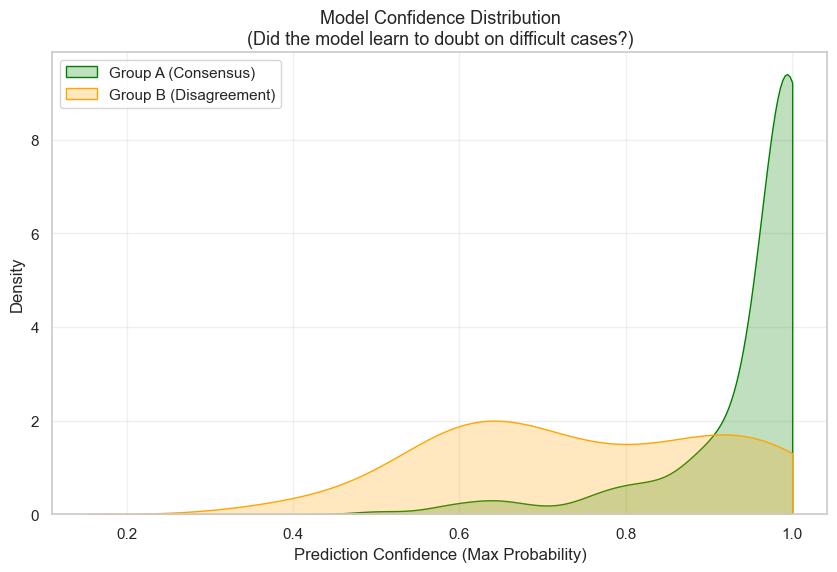
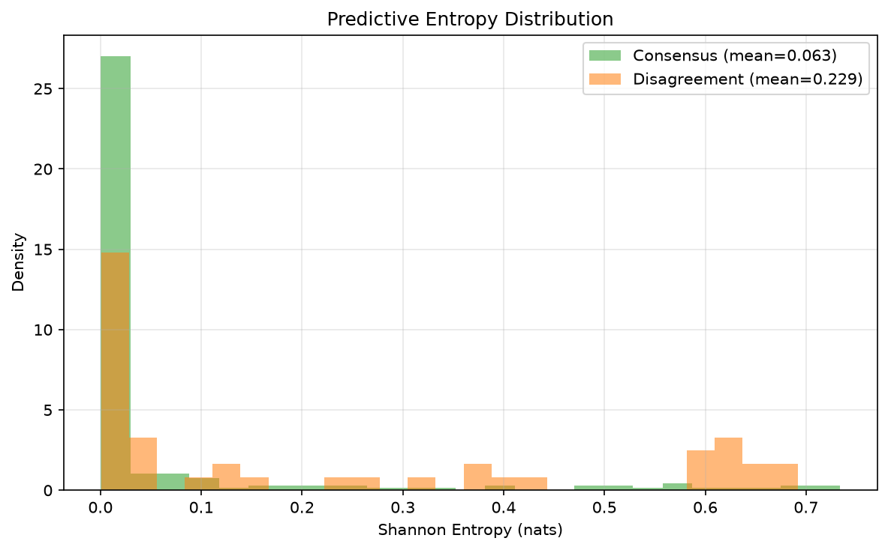
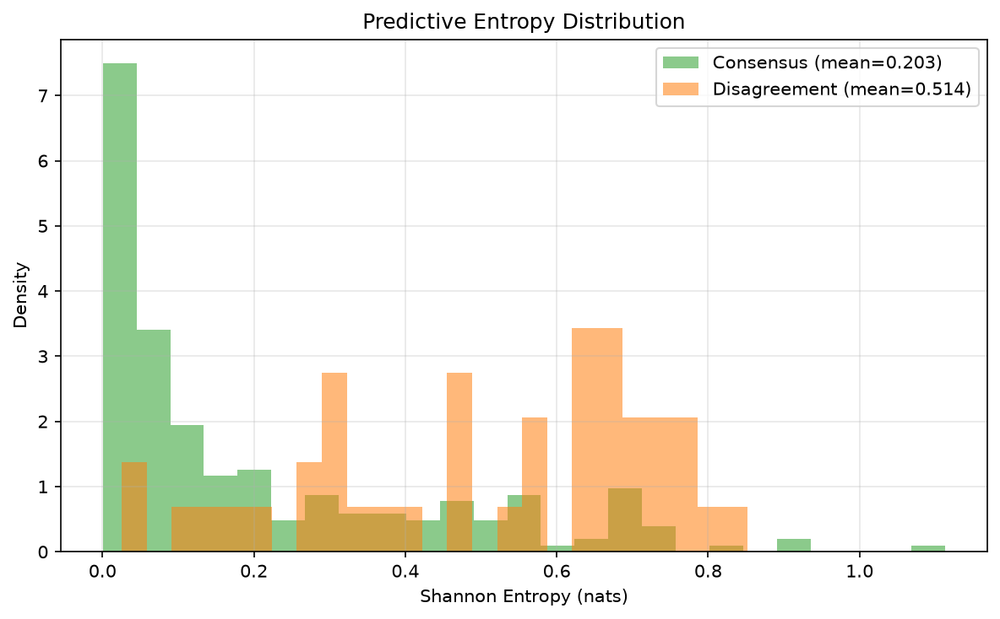
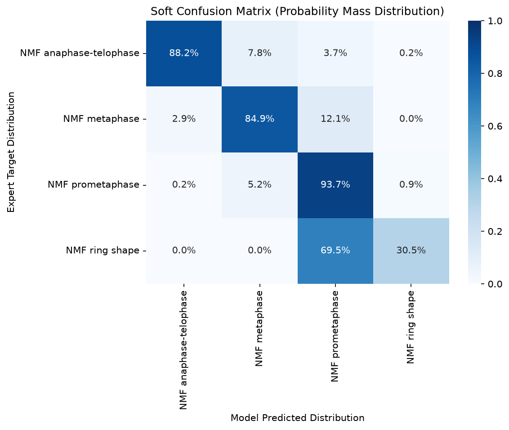
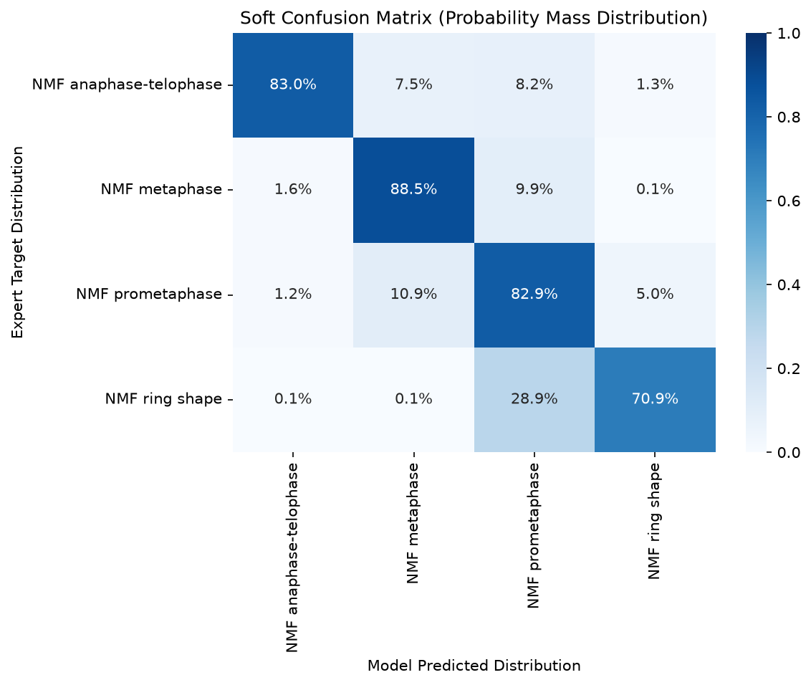
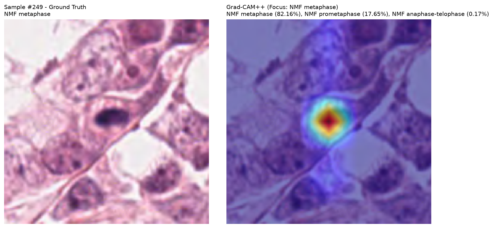
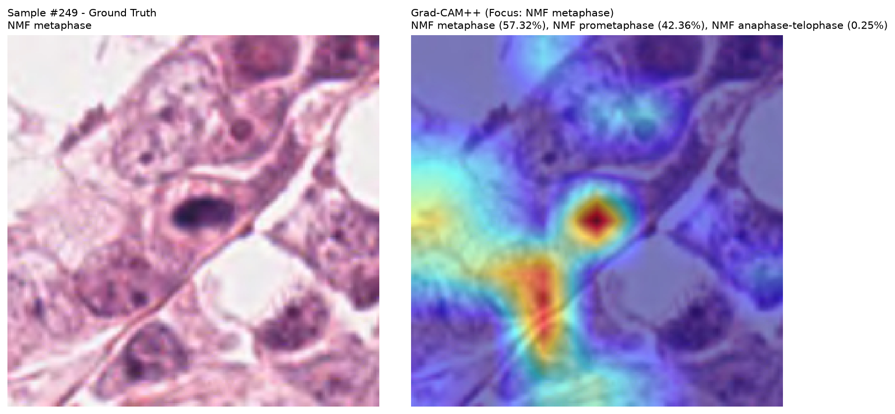

# Mitotic Phase Classification under Inter-Observer Uncertainty

**Probabilistic Soft Labeling, Uncertainty Calibration, and Explainability in Computational Pathology**

Developed during the Research Trimester at the **Centre for Computational Biology (CBIO), Mines Paris -- PSL** (with Institut Curie & INSERM U1331).

---

## Overview

Mitotic phase classification in breast cancer histopathology (*prometaphase, metaphase, anaphase-telophase, ring shape*) faces substantial **inter-observer variability**: because cell division is a biological continuum rather than discrete states, expert pathologists disagree on **15.5%** of normal mitotic figures in the **AMI-Br** dataset (2,200 normal mitotic patches from 3,720 total annotated cells).

Training deep classifiers with standard **hard one-hot labels** from a single annotator forces the network to memorize single-expert bias, degrades recall on minority classes, and produces overconfident predictions on biologically ambiguous transitions.

This repository implements a deterministic, reproducible PyTorch pipeline replacing hard targets with **bimodal probabilistic Soft Labels** derived directly from expert votes:
* **Consensus cases (Group A):** one-hot target ($y_i = 1.0$).
* **Disagreement cases (Group B):** bimodal target ($y_i = 0.5, y_j = 0.5$).

> **Team Collaboration Note:** The broader CBIO study was conducted collaboratively by A. Louis and E. Benyeloul under the supervision of T. Walter, L. Monnier, R. Bourgade, and G. Balezo. Multi-scanner UMAP domain-shift diagnostics and multi-center Macenko preprocessing were developed collaboratively within the CBIO team; this repository packages the **probabilistic Soft Labeling framework, deterministic GPU training pipeline, Double Coverage Accuracy (DCA) evaluation, confidence calibration, and Grad-CAM++ attribution analysis**.

---

## Reproducible Benchmark Results (Unfiltered AMI-Br Normal Mitotic Subset)

Strict A/B comparison of a `ConvNeXt-Tiny` backbone trained under identical deterministic conditions (`configs/default.yaml`: `seed=45`, `train_mode=full`, 50 epochs, `lr=1e-4`, `weight_decay=0.1`, `use_sampler=true`, `use_macenko=false`) differing **only** in `label_mode` (`hard` vs. `soft`), evaluated on the held-out test split ($n=275$: Group A $n=231$ consensus, Group B $n=44$ disagreement; best checkpoint selected by validation loss):

| Metric | Hard-Label Baseline (Ep. 21) | Proposed Soft Labels (Ep. 17) |
| :--- | :---: | :---: |
| **Overall Accuracy vs. Expert 1** | **93.09%** | 89.09% |
| **Balanced Accuracy vs. Expert 1** | 82.94% | **91.85%** *(+8.91 pp)* |
| **Macro F1 vs. Expert 1** | 0.824 | **0.826** |
| **Overall Accuracy vs. Expert 2** | 83.64% | **89.82%** *(+6.18 pp)* |
| **Balanced Accuracy vs. Expert 2** | 72.48% | **84.77%** *(+12.29 pp)* |
| **Macro F1 vs. Expert 2** | 0.739 | **0.878** *(+0.139)* |
| **Group A (Consensus, $n=231$) -- Accuracy** | 95.67% | **96.97%** |
| **Group B (Disagreement, $n=44$) -- Double Coverage Accuracy (DCA)** | 88.64% *(39/44)* | **97.73%** *(43/44)* |
| **Group B -- Relaxed Accuracy (Top-1 matches either expert)** | 100.00% | 100.00% |
| **Group A -- Mean Confidence (Max Softmax)** | 97.57% | 93.10% |
| **Group B -- Mean Confidence (Max Softmax)** | 89.72% *(overconfident)* | **76.06%** *(calibrated doubt)* |
| **Group A -- Mean Predictive Entropy** | 0.063 nats | 0.203 nats |
| **Group B -- Mean Predictive Entropy** | 0.229 nats | **0.514 nats** *(near $\ln 2 \approx 0.693$)* |

### Key Takeaways

* **Inter-expert neutrality vs. annotator bias:** Both models reach 100% relaxed accuracy on Group B ($n=44$), but the hard-label baseline memorizes Expert 1's bias (picking Expert 1 on **79.5%** of disputed cases), inflating raw Accuracy vs. Expert 1 while dropping to **83.64%** vs. Expert 2. The soft-label model splits symmetrically (**47.7%** E1 / **52.3%** E2), achieving balanced accuracy across both pathologists (**89.09%** vs. E1, **89.82%** vs. E2) and cutting Top-2 disagreement errors by **5x** (**97.73%** vs. **88.64%** DCA).
* **Minority-class recovery (`NMF ring shape`):** The hard-label baseline collapses to **50.0%** recall vs. Expert 1 (**28.6%** vs. Expert 2, leaking 69.5% of probability mass into `prometaphase`), whereas Soft Labels achieve **100.0%** recall vs. Expert 1 (**71.4%** vs. Expert 2), driving **+8.91 pp** Balanced Accuracy vs. E1 and **+0.139** Macro F1 vs. E2.
* **Calibrated uncertainty:** Soft supervision induces a **-17.04 pp** drop in mean confidence from consensus to disagreement cases (`93.10% -> 76.06%`, entropy `0.514 nats`), whereas hard supervision keeps most disputed samples overconfident (`89.72%`, entropy `0.229 nats`).

> **Historical Context (Original CBIO Trimester Study):** In the initial exploratory notebook run (with stochastic Macenko normalization active), the hard-label baseline suffered severe optimization collapse (`45.0%` overall accuracy, `43.72%` Group A, `70.45%` DCA, `95.10%` Group B confidence) vs. `93.0%` / `96.58%` / `90.24%` DCA / `79.90%` confidence for Soft Labels. Refactoring into a deterministic pipeline with `use_macenko=false` stabilizes hard-label optimization, providing a much stronger baseline while confirming that Soft Labeling consistently wins on DCA, minority-class recall, inter-expert neutrality, and uncertainty calibration.

### Double Coverage Accuracy (DCA)

Standard Top-2 accuracy only verifies whether *one* ground-truth class appears in the top 2 predictions. For disagreement samples where Expert 1 and Expert 2 assign distinct labels $y_{E1} \neq y_{E2}$, we define **Double Coverage Accuracy** to verify whether the unordered set of the model's top-2 predictions matches *both* experts exactly:

```math
\mathrm{DCA} = \frac{1}{N} \sum_{i=1}^{N} \mathbf{1}\left(\lbrace y_{E1}^{(i)}, y_{E2}^{(i)} \rbrace = \lbrace \hat{y}_{1}^{(i)}, \hat{y}_{2}^{(i)} \rbrace\right)
```

---

## Visual Diagnostics

### 1. Confidence Calibration (Group A Consensus vs. Group B Disagreement)
The hard-label model stays sharply peaked near 0.95--1.00 even on disputed cases, whereas the soft-label model preserves sharp confidence on canonical consensus cells while shifting its density on ambiguous cases toward 0.65--0.70:

| Hard-Label Baseline | Proposed Soft Labels |
| :---: | :---: |
|  |  |

### 2. Predictive Shannon Entropy Distribution
On disputed cells (Group B), the soft-label model raises predictive entropy to a mean of **0.514 nats** (approaching the $\ln 2 \approx 0.693$ nats entropy of a balanced two-expert split), whereas hard-label predictions remain compressed near zero entropy:

| Hard-Label Baseline | Proposed Soft Labels |
| :---: | :---: |
|  |  |

### 3. Probabilistic Soft Confusion Matrix ($Y_{\text{true}}^\top Y_{\text{pred}}$)
Soft supervision preserves probability mass along the diagonal for the rare `NMF ring shape` class (`70.9%` vs. `27.9%` in hard labels, where `69.5%` leaks into `prometaphase`):

| Hard-Label Baseline | Proposed Soft Labels |
| :---: | :---: |
|  |  |

### 4. Qualitative Attribution Inspection (Grad-CAM++ -- Sample #249)
Grad-CAM++ overlays provide qualitative insight into spatial focus. On cases such as Sample #249 (`NMF metaphase`), the soft-label model concentrates attribution directly onto the central chromatin plate while the hard-label baseline spreads activation toward peripheral stroma. Note that once both models converge cleanly, spatial localization varies across individual patches and would require quantitative localization benchmarks (e.g., Pointing Game / chromatin mask IoU) before claiming uniform spatial regularization:

| Hard-Label Baseline | Proposed Soft Labels |
| :---: | :---: |
|  |  |

---

## Repository Structure

```text
.
├── assets/                     # Benchmark figures (calibration, entropy, soft CM, Grad-CAM++)
├── configs/
│   └── default.yaml            # Immutable YAML experiment configuration
├── data/
│   └── README.md               # AMI-Br dataset download & expected layout
├── scripts/
│   ├── train.py                # CLI training entrypoint (soft or hard mode)
│   └── evaluate.py             # CLI evaluation battery (metrics JSON + headless figures)
├── src/mitotic_phases/
│   ├── config.py               # Frozen dataclasses + validated YAML I/O
│   ├── reproducibility.py      # Full CPU/CUDA determinism + DataLoader worker seeding
│   ├── data.py                 # Metadata audit, stratified splits, Dataset, MacenkoAugment
│   ├── model.py                # ConvNeXt factory, freezing policies, single-pass extractor
│   ├── metrics.py              # Pure testable metrics (DCA, bounded acc, soft CM, entropy)
│   ├── trainer.py              # Training loop with CPU weight snapshotting & checkpointing
│   └── visualization.py        # Headless plotting (calibration, confusion matrices, t-SNE, CAM)
├── tests/
│   ├── test_config.py          # YAML round-trip & schema validation
│   ├── test_metrics.py         # DCA, soft targets, bounded accuracy, calibration & entropy
│   └── test_pipeline.py        # Determinism, shared vocab, ConvNeXt freezing, Trainer smoke
└── pyproject.toml              # PEP 621 packaging, Ruff, Mypy (strict), Pytest
```

---

## Installation

Using [`uv`](https://docs.astral.sh/uv/) (recommended):

```bash
git clone https://github.com/elyesse73/mitotic_phases.git
cd mitotic_phases

# Core package + dev tools (pytest, ruff, mypy)
uv sync --extra dev

# Optional: full training/explainability stack (Macenko stain normalization + Grad-CAM++)
uv sync --extra full --extra dev
```

Or with standard `pip`:

```bash
pip install -e ".[dev]"
# Optional full stack:
pip install -e ".[full,dev]"
```

---

## Usage

### Run the Test Suite & Static Checks (CPU-only, < 5s)

```bash
uv run pytest -v
uv run ruff check src scripts tests
uv run mypy src
```

### Train a Model (Soft Labels or Hard-Label Baseline)

```bash
# Proposed probabilistic Soft Labeling (default config: seed=45, 50 epochs, ConvNeXt-Tiny)
uv run python scripts/train.py --config configs/default.yaml --label-mode soft --output-dir outputs/soft

# Hard-Label baseline (Expert 1 one-hot targets)
uv run python scripts/train.py --config configs/default.yaml --label-mode hard --output-dir outputs/hard
```

### Run Full Evaluation & Export Figures

```bash
uv run python scripts/evaluate.py \
  --config configs/default.yaml \
  --checkpoint outputs/soft/best_model_soft.pth \
  --split test \
  --output-dir outputs/soft_eval
```

All metrics are exported to `evaluation_test.json` and diagnostic plots are saved headlessly under `figures/`.

---

## Known Methodological Limitations & Future Work

This study was conducted within a two-month research trimester. With hindsight, four methodological upgrades would be required before clinical translation:

* **Slide-level & OOD validation:** Dataset splits currently operate at the patch level rather than grouping by Whole Slide Image (`slide`) or holding out an unseen scanner hardware domain. Strict generalization testing requires `StratifiedGroupKFold` grouped by slide alongside Leave-One-Scanner-Out evaluation.
* **Prior shift under class balancing:** Oversampling minority phases with `WeightedRandomSampler` optimizes posteriors under a uniform prior rather than natural biological prevalence; strict probability calibration requires post-hoc logit adjustment or prior-aware losses.
* **Multi-seed baselines & proper scoring rules:** Multi-seed runs with warmup/cosine scheduling (to curb post-epoch-20 overfitting), direct ablations against uniform Label Smoothing and post-hoc Temperature Scaling, and strictly proper scoring rules (KL divergence, Brier score, ECE, and ambiguity-detection AUROC) would cleanly separate soft-target representation gains from generic regularization.
* **Ordinal structure & annotator modeling:** Standard cross-entropy penalizes adjacent biological transitions identically to distant phase errors; ordinal losses and explicit rater-bias models (e.g., Dawid-Skene or CrowdLayer with 5+ pathologists) would better disentangle intrinsic biological ambiguity from individual annotator bias.

---

## Note on Code Refactoring & AI Assistance

The underlying experiments and scientific analysis were originally developed in exploratory notebooks during the CBIO Research Trimester. This repository is a post-project refactoring into a reproducible, typed Python package (`src/` layout, headless CLIs, deterministic seeding, and unit tests). LLM coding assistants (**Gemini 4 Neon**, **Gemini 4 Hydrogen**) were used to accelerate refactoring and test scaffolding; all architecture, bug fixes, and numerical behaviors were audited and verified locally via `pytest`, `ruff`, and `mypy --strict`, and re-validated end-to-end on GPU.

## License

Academic and research use. Dataset rights remain with the original AMI-Br authors (Bertram et al., *Scientific Data*, 2025).
