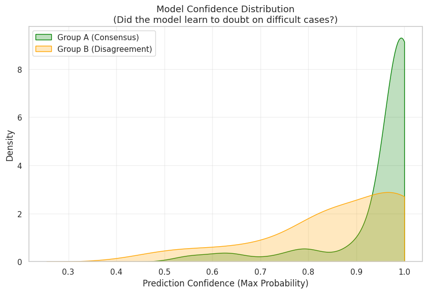
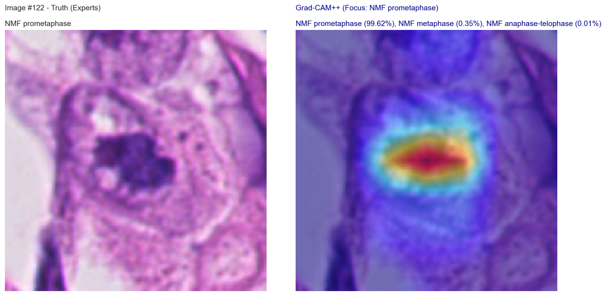

# Mitotic Phase Classification under Inter-Observer Uncertainty

**Probabilistic Soft Labeling, Uncertainty Calibration, and Spatial Regularization in Computational Pathology**

Developed during the Research Trimester at the **Centre for Computational Biology (CBIO), Mines Paris -- PSL** (with Institut Curie & INSERM U1331).

---

## Overview

Mitotic phase classification in breast cancer histopathology (*prometaphase, metaphase, anaphase-telophase, ring shape*) faces substantial **inter-observer variability**: because cell division is a biological continuum rather than discrete states, expert pathologists disagree on **15.5%** of normal mitotic figures in the **AMI-Br** dataset (2,200 normal mitotic patches from 3,720 total annotated cells).

Training deep classifiers with standard **hard one-hot labels** on discordant annotations induces severe gradient conflicts, causing optimization collapse, scattered background attention, and dangerously overconfident predictions on ambiguous cells.

This repository implements a reproducible PyTorch pipeline replacing hard targets with **bimodal probabilistic Soft Labels** derived directly from expert votes:
* **Consensus cases (Group A):** one-hot target ($y_i = 1.0$).
* **Disagreement cases (Group B):** bimodal target ($y_i = 0.5, y_j = 0.5$).

> **Team Collaboration Note:** The broader CBIO study was conducted collaboratively by A. Louis and E. Benyeloul under the supervision of T. Walter, L. Monnier, R. Bourgade, and G. Balezo. Multi-scanner UMAP domain-shift diagnostics and multi-center Macenko preprocessing were developed collaboratively within the CBIO team; this repository packages the **probabilistic Soft Labeling framework, deterministic GPU training pipeline, Double Coverage Accuracy (DCA) evaluation, confidence calibration, and Grad-CAM++ attribution analysis**.

---

## Key Results (Unfiltered AMI-Br Normal Mitotic Subset)

Comparison of a `ConvNeXt-Tiny` backbone trained with **Hard Labels (Expert 1)** vs. **Proposed Soft Labels** on the exact same unfiltered dataset:

| Metric | Hard-Label Baseline | Proposed Soft Labels |
| :--- | :---: | :---: |
| **Overall Accuracy vs. Expert 1** | 45.0% | **93.0%** (Macro F1: 0.81) |
| **Overall Accuracy vs. Expert 2** | -- | **87.0%** (Macro F1: 0.74) |
| **Group A (Consensus, $n=234$) -- Accuracy** | 43.72% | **96.58%** |
| **Group B (Disagreement, $n=41$) -- Double Coverage Accuracy (DCA)** | 70.45% | **90.24%** |
| **Group A -- Mean Confidence (Max Softmax)** | 93.00% | **95.40%** |
| **Group B -- Mean Confidence (Max Softmax)** | 95.10% *(overconfident)* | **79.90%** *(calibrated doubt)* |

### Double Coverage Accuracy (DCA)

Standard Top-2 accuracy only verifies whether *one* ground-truth class appears in the top 2 predictions. For disagreement samples where Expert 1 and Expert 2 assign distinct labels $y_{E1} \neq y_{E2}$, we define **Double Coverage Accuracy** to verify whether the unordered set of the model's top-2 predictions matches *both* experts exactly:

```math
\mathrm{DCA} = \frac{1}{N} \sum_{i=1}^{N} \mathbf{1}\left(\lbrace y_{E1}^{(i)}, y_{E2}^{(i)} \rbrace = \lbrace \hat{y}_{1}^{(i)}, \hat{y}_{2}^{(i)} \rbrace\right)
```

---

## Visual Diagnostics

### 1. Confidence Calibration (Group A Consensus vs. Group B Disagreement)
The hard-label baseline stays sharply overconfident even when pathologists disagree, whereas the soft-label model maintains high confidence on canonical consensus cells while flattening its confidence distribution on ambiguous transitions:

| Hard-Label Baseline | Proposed Soft Labels |
| :---: | :---: |
|  |  |

### 2. Soft Labeling as a Spatial Regularizer (Grad-CAM++ — Sample #122)
By removing gradient conflicts from contradictory hard annotations, soft supervision concentrates spatial activations onto chromatin morphology instead of background tissue and patch borders:

| Hard-Label Baseline (Scattered Attention) | Proposed Soft Labels (Chromatin Focus) |
| :---: | :---: |
|  |  |

---

## Repository Structure

```text
.
├── assets/                     # Report figures (calibration & Grad-CAM++ comparisons)
├── configs/
│   └── default.yaml            # Immutable YAML experiment configuration
├── data/
│   └── README.md               # AMI-Br dataset download & expected layout
├── scripts/
│   ├── train.py                # CLI training entrypoint (soft or hard mode)
│   └── evaluate.py             # CLI evaluation battery (metrics JSON + headless figures)
├── src/mitotic_phases/
│   ├── config.py               # Frozen dataclasses + validated YAML I/O
│   ├── reproducibility.py      # Full CPU/CUDA determinism + DataLoader worker seeding
│   ├── data.py                 # Metadata audit, stratified splits, Dataset, MacenkoAugment
│   ├── model.py                # ConvNeXt factory, freezing policies, single-pass extractor
│   ├── metrics.py              # Pure testable metrics (DCA, bounded acc, soft CM, entropy)
│   ├── trainer.py              # Training loop with CPU weight snapshotting & checkpointing
│   └── visualization.py        # Headless plotting (calibration, confusion matrices, t-SNE, CAM)
├── tests/
│   ├── test_config.py          # YAML round-trip & schema validation
│   ├── test_metrics.py         # DCA, soft targets, bounded accuracy, calibration & entropy
│   └── test_pipeline.py        # Determinism, shared vocab, ConvNeXt freezing, Trainer smoke
└── pyproject.toml              # PEP 621 packaging, Ruff, Mypy (strict), Pytest
```

---

## Installation

Using [`uv`](https://docs.astral.sh/uv/) (recommended):

```bash
git clone https://github.com/elyesse73/mitotic_phases.git
cd mitotic_phases

# Core package + dev tools (pytest, ruff, mypy)
uv sync --extra dev

# Optional: full training/explainability stack (Macenko stain normalization + Grad-CAM++)
uv sync --extra full --extra dev
```

Or with standard `pip`:

```bash
pip install -e ".[dev]"
# Optional full stack:
pip install -e ".[full,dev]"
```

---

## Usage

### Run the Test Suite & Static Checks (CPU-only, < 5s)

```bash
uv run pytest -v
uv run ruff check src scripts tests
uv run mypy src
```

### Train a Model (Soft Labels or Hard-Label Baseline)

```bash
# Proposed probabilistic Soft Labeling (default config: seed=45, 50 epochs, ConvNeXt-Tiny)
uv run python scripts/train.py --config configs/default.yaml --label-mode soft --output-dir outputs/soft

# Hard-Label baseline (Expert 1 one-hot targets)
uv run python scripts/train.py --config configs/default.yaml --label-mode hard --output-dir outputs/hard
```

### Run Full Evaluation & Export Figures

```bash
uv run python scripts/evaluate.py \
  --config configs/default.yaml \
  --checkpoint outputs/soft/best_model_soft.pth \
  --split test \
  --output-dir outputs/soft_eval
```

All metrics are exported to `evaluation_test.json` and diagnostic plots are saved headlessly under `figures/`.

---

## Known Methodological Limitations & Future Work

This study was conducted within a two-month research trimester. With hindsight, four methodological upgrades would be required before clinical translation:

* **Slide-level & OOD validation:** Dataset splits currently operate at the patch level rather than grouping by Whole Slide Image (`slide`) or holding out an unseen scanner hardware domain. Strict generalization testing requires `StratifiedGroupKFold` grouped by slide alongside Leave-One-Scanner-Out evaluation.
* **Prior shift under class balancing:** Oversampling minority phases with `WeightedRandomSampler` optimizes posteriors under a uniform prior rather than natural biological prevalence; strict probability calibration requires post-hoc logit adjustment or prior-aware losses.
* **Multi-seed baselines & proper scoring rules:** Multi-seed runs with warmup/cosine scheduling, direct ablations against uniform Label Smoothing and post-hoc Temperature Scaling, and strictly proper scoring rules (KL divergence, Brier score, ECE, and ambiguity-detection AUROC) would cleanly separate soft-target representation gains from generic regularization.
* **Ordinal structure & annotator modeling:** Standard cross-entropy penalizes adjacent biological transitions identically to distant phase errors; ordinal losses and explicit rater-bias models (e.g., Dawid-Skene or CrowdLayer with 5+ pathologists) would better disentangle intrinsic biological ambiguity from individual annotator bias.

---

## Note on Code Refactoring & AI Assistance

The underlying experiments and scientific analysis were originally developed in exploratory notebooks during the CBIO Research Trimester. This repository is a post-project refactoring into a reproducible, typed Python package (`src/` layout, headless CLIs, deterministic seeding, and unit tests). LLM coding assistants (**Gemini 4 Neon**, **Gemini 4 Hydrogen**) were used to accelerate refactoring and test scaffolding; all architecture, bug fixes, and numerical behaviors were audited and verified locally via `pytest`, `ruff`, and `mypy --strict`.

## License

Academic and research use. Dataset rights remain with the original AMI-Br authors (Bertram et al., *Scientific Data*, 2025).